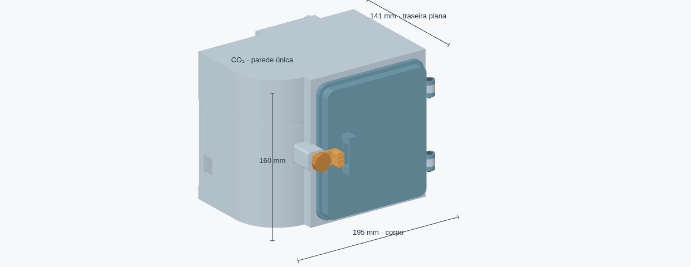
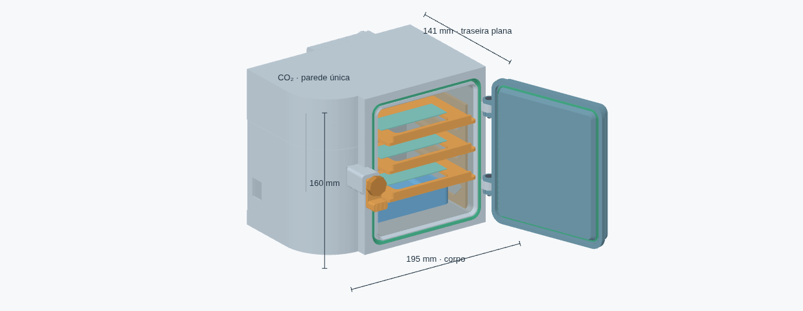
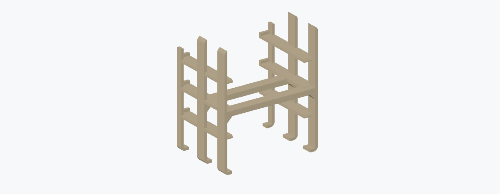
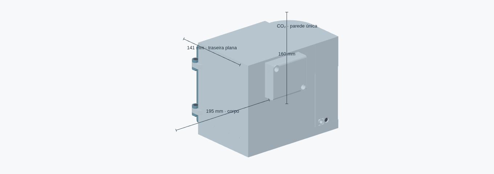
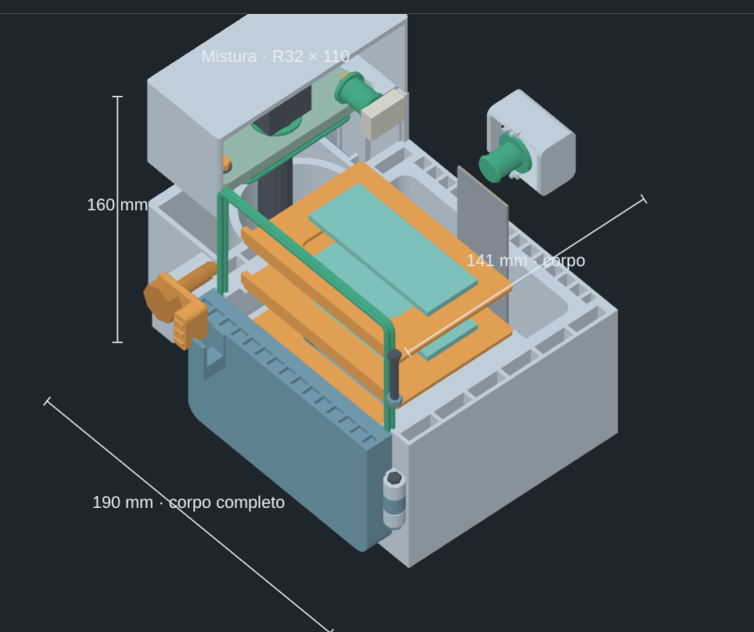
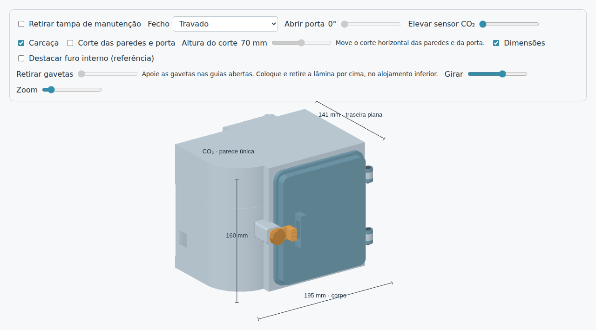

# Mini incubadora CO₂ — v59

Modelo mecânico para impressão 3D, desenvolvido em CadQuery, com porta articulada,
três gavetas removíveis, reservatório de água e compartimentos de CO₂ e eletrônica.
A versão atual completa a rampa a 45° atrás da base da lingueta, incluindo seu lado externo.
As gavetas usam guias abertas e as lâminas são apoiadas somente por baixo.
Vedação, resistência e funcionamento térmico ainda precisam de validação física.



## Arquivos para visualizar e imprimir

- [Visualizador interativo offline](output/visualizador.html): baixe e abra no navegador.
- [Projeto Creality Print 7.2.1](output/incubadora_CrealityPrint_7.2.1.3mf): 39 peças em 36 bandejas, incluindo molde e contraformas, escala 1:1, sem fatiamento ou G-code.
- [Molde e contraforma do inox](output/v59/ferramental_inox/LEIA_ME.md): macho e duas metades de fechamento, com STL e STEP.
- [STL da carcaça com a traseira na mesa](output/v59/impressao_traseira_na_mesa/corpo_integrado.stl).
- [STL, STEP, amostras e relatórios da v59](output/v59/).
- [Conjunto completo em STEP](output/v59/conjunto.step).
- [Situação técnica e pendências](STATUS.md).

O GitHub não executa o HTML: salve o arquivo localmente para usar os controles.
Os arquivos de versões antigas foram removidos da árvore atual; podem ser recuperados pelo histórico do Git.

## Medidas principais

As medidas estão em milímetros. Largura × altura × profundidade para a câmara e o inox.

| Elemento | Medida |
| --- | --- |
| Carcaça na orientação de montagem, largura × profundidade × altura | 195 × 141 × 160 |
| Carcaça com a traseira na mesa, largura × profundidade da mesa × altura de impressão | 195 × 160 × 141 |
| Câmara rígida interna | 112 × 132 × 111; cantos R6 |
| Caixa inox, dimensão externa de referência | 111 × 131 × 110 |
| Caixa inox, dimensão interna de referência | 110,4 × 130,4 × 109,7 |
| Espessura do inox de referência | 0,3 |
| Gavetas, largura × profundidade × espessura da base | 102,2 × 72 × 3 |
| Passo vertical entre gavetas | 29 |
| Alojamento das lâminas | 76,8 × 26,8; rebaixo de 0,6 |
| Caixinha traseira, largura × altura × profundidade | 70 × 60 × 21 |

A caixa inox e o [molde de referência](output/v59/molde_caixa_inox_referencia.stl)
não constituem um plano de corte de chapa: dobras, raios e acabamento precisam ser
conferidos na fabricação. Os furos de referência do inox alinham as passagens de CO₂ e fios.

## Vedações eSUN TPU-LW

Para imprimir somente as novas vedações, abrir [vedacoes_eSUN_TPU_LW.3mf](output/v59/vedacoes_eSUN_TPU_LW.3mf).
Doze bandejas, uma peça por impressão: junta removível da porta (9,95 / 6,25 mm),
amostra da dobradiça, quatro metades das rolhas, bucha do sensor CO₂ e duas
amostras, junta da caixa para reposição e duas amostras. Todas as peças antes
atribuídas ao TPU convencional agora usam eSUN TPU-LW.
**Manter a junta da caixa instalada, sem removê-la ou forçar o PC.**
Consultar o [guia de montagem e calibração](output/v59/VEDACAO_TPU_LW.md):
retração zero; 270 °C e fluxo experimental 0,55 ainda dependem de calibração física.
O projeto completo contém as peças atualizadas, preservando as demais configurações.

## Porta, vedação e acesso

A porta é uma peça rígida, com todo o ressalto interno em V de ponta plana.
O ressalto entra no perfil correspondente do corpo. A nova junta oca TPU-LW
fica no canal da porta; a junta TPU já instalada no corpo permanece intacta.
A junta removível da porta agora usa TPU-LW com cavidade fechada e projeção
reduzida na dobradiça, sem depender da borda quebrada; a junta do corpo é preservada. O manípulo central regula a compressão.
A estanqueidade depende do ajuste e de ensaio físico.

Para abrir, afrouxe o manípulo e gire a lingueta central 90° para baixo.
A pega lateral é uma dupla hélice circular real, com duas curvas vistas de frente,
hastes cilíndricas Ø3,2 mm e travessas Ø2,2 mm. Os apoios são curvos e se
alargam gradualmente até a porta, com raio de 1,8 a 4 mm.
A hélice tem raio de 6 mm e uma volta completa ao longo de 36 mm;
o envelope com apoios tem altura de 54 mm, profundidade de 15,2 mm e
projeção de 18,6 mm além da placa. Imprimir com a **frente externa plana na mesa**
e o ressalto interno em V para cima, com suportes externos para a hélice.
O isolamento da porta foi redesenhado para essa posição: 30 canais alongados,
em duas fileiras, com paredes de 2 mm. Os tetos avançam a 45° no sentido +Y
do CAD e fecham pela largura curta de cada canal, com ponte final de 0,4 mm.
A [conferência das rampas](output/v59/door_roof_report.json) e o
[fatiamento de teste deitada](output/v59/door_slice_report.json) estão registrados.
No visualizador, escolha **Impressão da porta · frente para baixo** e mova
**Camada da porta** entre 5,2 e 8 mm para ver os canais fechando.
Os vazados pertencem somente à pega externa: nenhum corte atravessa a porta,
as células de isolamento ou o perímetro de vedação. O canal e as juntas TPU
foram preservados. Ergonomia e estanqueidade dependem de teste físico.
As duas dobradiças usam M4 × 20 escareados, porcas metálicas na porta e buchas de compressão.
Os apoios fixos têm rampas externas a 45° para impressão da carcaça com a traseira na mesa.
Atrás das duas dobradiças e da base da lingueta, as rampas dentro da parede também
fecham a 45°, substituindo os tetos retos sobre as cavidades de isolamento.
A base da lingueta também tem rampa externa, eliminando a face traseira reta que
ainda ficava suspensa. O reforço preserva o volume interno do compartimento de CO₂.



O misturador de CO₂ tem teto integrado, com abertura para o sensor.
A tampa lateral removível dá acesso à eletrônica: solte seu M4 × 12 e retire-a para cima.
A entrada de gás recebe mangueira de silicone Ø externo 6,0 em alojamento Ø6,2,
com boca chanfrada Ø6,8 e profundidade de encaixe de 12 mm.
O canal interno de comunicação com a câmara e o furo correspondente no inox têm Ø6,2.
A folga diametral nominal é de 0,2 mm; conferir encaixe e vedação nas amostras OD6.
O canal não bloqueia retorno de umidade.

## Gavetas e lâminas

O suporte removível tem laterais abertas, H de travamento na frente e no meio da profundidade e apoios de 10 mm de largura.
Cada apoio avança 10 mm para dentro, com sobreposição mínima nominal de 8,4 mm sob a gaveta.
As gavetas entram pela frente em guias abertas, com chanfro de entrada de 2 mm
e folga lateral de 0,8 mm por lado. Apoie a gaveta nos dois trilhos e deslize até o batente traseiro.
Não há tampa superior do trilho nem encaixe estreito para alinhar.
Para retirar completamente, puxe a gaveta segurando-a quando ela deixar os apoios.



A lâmina fica num rebaixo de 0,6 mm na própria base. O apoio é somente inferior;
as bordas do rebaixo limitam o deslocamento horizontal. Coloque e retire a lâmina
por cima. Não há presilhas, lingueta ou material sobre sua área.
O alojamento aberto permite levantar a lâmina e não a retém se a gaveta for invertida.

O desenho foi conferido para lâminas de 76 × 26 e 75 × 25, com espessuras de 0,9 a 1,2.
A referência visual mede 76 × 26 × 1. A área central da gaveta permanece vazada.


## Caixinha traseira e passagens

A caixinha de 70 × 60 × 21 acomoda a sobra dos fios e tem furo do conector lateral Ø10,68 mm.
As bordas superior e inferior que tocam a incubadora são retas.
A fixação usa dois M4 × 12, com aproximadamente 4 mm de engate no corpo.
Os pilotos são cegos, dentro de apoios maciços Ø16: há 5,6 mm de material atrás
do piloto e 6,25 mm nas laterais. A parede quente de 4 mm permanece contínua sob os apoios.

As passagens de fios usam buchas TPU. Montagem dos fios, compressão das buchas,
retenção dos parafusos e vedação precisam ser conferidas com os componentes reais.
Teste primeiro a [amostra da fixação M4](output/v59/amostra_caixinha_fixacao_M4.stl).



## Impressão

A orientação da **carcaça** é com a traseira apoiada na mesa.
Use o STL indicado acima ou a bandeja da carcaça no projeto Creality Print.
A camada de isolamento tem 23 cavidades alongadas, faces de 2 mm e fechamento a 45°,
com ponte final nominal de 0,4 mm. A parede da câmara tem 4 mm.
Os furos e as fixações mantêm reforços locais maciços.



Materiais previstos no desenho: PC para peças rígidas, eSUN TPU-LW para todas
as vedações e inox de 0,3 mm para o revestimento. O projeto completo preserva
os perfis salvos pelo usuário; todas as dez peças flexíveis usam o perfil TPU-LW.
O antigo perfil TPU convencional permanece salvo, sem objetos atribuídos.
Usar o arquivo separado de vedações para imprimir uma peça por vez, a 25 mm/s,
270 °C, fluxo experimental 0,55 e retração zero. As doze bandejas passam no
fatiamento sem suportes; encaixe e estanqueidade dependem de ensaio físico.
STL e STEP contêm geometria; as configurações ficam no projeto 3MF.

Antes de imprimir, confira na prévia de camadas:

- Ausência de suporte preso dentro das cavidades fechadas da carcaça.
- Perímetros e continuidade de material ao redor de furos e vedações.
- Pontes, encaixes, roscas e pequenos detalhes com os parâmetros escolhidos.
- Orientação da porta: ainda não foi definida nem validada.

O suporte das gavetas foi desenhado para a traseira na mesa; as janelas fecham a 45°.
As gavetas têm base plana. As orientações das demais peças no projeto devem ser revisadas.
Imprima as amostras de encaixe e vedação antes de comprometer a carcaça inteira.

## Visualizador



- Arraste o modelo para girar e use **Zoom** para aproximar.
- Selecione **Fecho → Afrouxado e girado 90°** para abrir a porta.
- A retirada das gavetas é liberada no visualizador a partir de 90° de abertura.
- Use **Corte das paredes e porta** e **Altura do corte** para inspecionar as cavidades.
- Em **Peças**, marque componentes ou use **Isolar**.

Os controles mostram a geometria; não substituem testes físicos.

## Controle do Arduino pela USB

### Preparar, compilar e gravar

A placa usada é Arduino Uno R3 (`arduino:avr:uno`). O código fonte permanece em
[temperatura.ino](temperatura.ino); a pasta [firmware/incubadora](firmware/incubadora)
é a entrada de sketch exigida pelo Arduino CLI. A biblioteca `NDIRZ16` está incluída
em `arduino-libraries/`; as outras versões ficam fixadas no script.

Instale o [Arduino CLI](https://arduino.github.io/arduino-cli/latest/installation/)
1.5.1 no Linux:

```bash
curl -fsSL https://raw.githubusercontent.com/arduino/arduino-cli/master/install.sh | BINDIR="$HOME/.local/bin" sh -s 1.5.1
```

No diretório do projeto, prepare as ferramentas e bibliotecas uma vez:

```bash
scripts/arduino.sh setup
```

Para compilar, gravar e abrir o monitor serial:

```bash
scripts/arduino.sh compile
scripts/arduino.sh upload
scripts/arduino.sh monitor
```

O padrão da porta é `/dev/ttyACM0`; substitua por `ARDUINO_PORT=/dev/ttyUSB0` se
necessário. No Linux, se o usuário não tiver acesso direto à porta, use o grupo
`dialout` para cada comando, por exemplo:

```bash
sg dialout -c 'scripts/arduino.sh upload'
sg dialout -c 'scripts/arduino.sh monitor'
```

O upload compila primeiro e verifica o firmware gravado. Feche qualquer outro monitor
serial antes de compilar/gravar. A compilação atual usa 31.978 bytes de Flash (99%) e
825 bytes de RAM global (40%), deixando 278 bytes de Flash e 1.223 bytes de RAM para
pilha e chamadas.

A tela numérica fixa mostra CO₂, temperatura, umidade, temperatura interna e taxa de
variação do CO₂, mantendo os ícones animados e os estados ON/OFF na faixa inferior.
O cabeçalho mantém a cor de estado e o contador de reinicializações. As bolhas sobem
por 3 s após um pulso, a chama oscila enquanto o aquecedor está energizado e o rotor
gira enquanto o ventilador funciona. Leituras sem alteração não redesenham os campos
de texto.

As cores de fundo indicam falha, espera ou operação normal. Durante o aquecimento do
sensor, três pontos reutilizam as bolhas de CO₂ como animação de espera; o desenho grande
de DNA foi retirado para reservar espaço de firmware às animações e ao controle da incubadora.

O firmware está em [temperatura.ino](temperatura.ino). Abra a porta serial a **9600 baud**;
cada comando deve terminar com uma quebra de linha. `DATA` contém uma linha CSV por
ciclo, `EVENT` registra transições e falhas, e `STATUS` consulta sensores, saídas e
estado do controle, incluindo `boot_count`. `rate_ppm_min` é a variação líquida de CO₂
normalizada para ppm/min numa janela móvel de aproximadamente 30 segundos; o campo
`rate_ppm_min_valid` indica quando a janela já está disponível. A mesma taxa aparece na
tela, com sinal positivo para ganho e negativo para perda, ajudando a observar vazamentos.
A telemetria mantém uma casa decimal para temperatura/umidade e duas para as taxas,
formatadas em ponto fixo para reduzir o uso de Flash no Uno.
A linha `BOOT_COUNT` e o campo `boot_count`
leem o contador salvo na EEPROM; ele incrementa uma vez por inicialização, sem gravações
por ciclo. Falha de comunicação e leitura de 0 ppm são eventos separados;
ambos ficam fora do controle automático.

As cores do indicador representam as duas metas principais: vermelho quando CO₂ e
temperatura estão fora da faixa, amarelo quando apenas uma está na faixa e verde quando
ambas estão na faixa. As faixas atuais são 48.000–50.000 ppm e 36,9–37,1 °C. O aquecedor
liga em 36,9 °C e desliga em 37,0 °C, com corte de segurança em 37,1 °C. O valor
medido é separado da meta: o protocolo UART do MH-Z16 entrega ppm em um campo de 16 bits
(até 65.535 ppm). Uma queda de faixa compatível com rollover acima de 60.000 ppm trava
a injeção e gera um evento, para não interpretar o valor baixo subsequente como falta de
CO₂.

Comandos disponíveis:

```text
HELP
STATUS
CO2 ON
CO2 OFF
CO2 PRIME
HEAT ON
HEAT OFF
ALL OFF
```

`CO2 ON` habilita o controle automático; `HEAT ON` habilita o termostato. `ALL OFF`
desliga a injeção e o aquecedor. Esses estados são salvos na EEPROM, como os botões
físicos. O termostato liga em 36,9 °C e desliga a partir de 37,0 °C,
com pelo menos 10 s de espera antes de religar e limite de 10 s por acionamento.
O corte de segurança fica em 37,1 °C. A faixa visual esperada é 36,9–37,1 °C;
esse controle ainda precisa de validação térmica prolongada. Enquanto o CO₂ estiver
abaixo de 50.000 ppm, o automático inicia uma dose quando a leitura não está subindo
rapidamente. Após reinício, a primeira dose é escalada pela distância à meta, com
referência inicial conservadora de 12 ppm por ms e teto de 60 ms. Depois de cada dose, o controle espera
ao menos cerca de um minuto e só libera outra dose depois que a subida ficar abaixo de
300 ppm/min por 30 s contínuos. A telemetria mostrou resposta atrasada além do minuto;
esse intervalo adicional evita somar pulsos enquanto o CO₂ ainda está subindo. Uma
leitura em queda não bloqueia a correção.
O tempo é recalibrado pela elevação máxima de ppm observada após cada pulso, então
acompanha mudanças na vazão causadas pela pressão do reservatório ou pelo ajuste manual
da válvula. Como a pressão não é medida diretamente e a resposta do sensor é atrasada,
cada resposta atualiza em um terço a eficiência estimada; isso evita que uma única
amostra determine a dose seguinte. O controle calcula o pulso pela distância à meta e
pela eficiência suavizada, limitado a 1.000 ms por pulso. A primeira dose após reinício
usa a referência observada de 12 ppm/ms e fica limitada a 60 ms. O piso é 5 ms para
evitar pulsos abaixo da resolução prática da válvula. O bloqueio de tendência evita
empilhar pulsos durante a subida atrasada.
O controle automático aguarda também 3 minutos após cada reinicialização, conforme o
pré-aquecimento indicado no manual do MH-Z16; o pulso manual permanece disponível.
`CO2 PRIME` solicita um pulso manual de 5 ms. No botão, 3 toques solicitam 5 ms, 4
toques 10 ms e 5 toques 20 ms, dentro de uma janela de três segundos. Os pulsos de 3
ou 4 toques saem ao fim da janela, para o firmware distinguir a sequência; o quinto
toque dispara imediatamente. Isso permite uma dose manual progressiva enquanto o
controle automático mantém o estado que já tinha. Se houver uma leitura de CO₂ no
limite configurado (50.000 ppm) ou acima, o pulso é recusado. Sem leitura disponível,
o pulso é permitido e o firmware começa a aprender a resposta quando chegarem leituras
válidas. Toques intermediários não são gravados na EEPROM. Um toque simples alterna o
modo automático ao fim da janela de três segundos.
Após cada pulso de CO₂, o controle aguarda aproximadamente um minuto para observar a
resposta do sensor antes de permitir outro. A serial não oferece comando de abertura
direta da válvula. O MH-Z16 não informa a faixa configurada por uma consulta UART; a
antiga consulta `0x7D` só ecoava o comando e não deve ser usada para confirmar a faixa.
Na telemetria `DATA`, `next_pulse_ms` é o próximo valor calculado e `last_pulse_ms` é o
tempo do pulso realmente aplicado; ambos são separados de `valve_open`, que mostra o
estado instantâneo da saída.

## Gerar os arquivos

Na pasta do repositório:

```bash
python3 -m venv .venv
.venv/bin/python -m pip install -r requirements.txt
.venv/bin/python cad/model.py
.venv/bin/python cad/check_k1c.py
.venv/bin/python cad/build_viewer.py
.venv/bin/python cad/build_creality_project.py --version v59
.venv/bin/python cad/check_creality_project.py --version v59
```

O gerador confere sólidos, interferências e movimentos específicos da porta,
gavetas e lâminas. Os testes adicionais de movimento/roscas são opcionais:

```bash
.venv/bin/python cad/model.py --check-movements
```

Para servir o visualizador na rede local:

```bash
mkdir -p /tmp/incubadora3d-viewer
cp output/visualizador.html /tmp/incubadora3d-viewer/index.html
python3 -m http.server 8081 --bind 0.0.0.0 --directory /tmp/incubadora3d-viewer
```

Acesse `http://IP_DO_SERVIDOR:8081/` com a porta acessível na rede.

## Validação disponível

A v59 passou em 60 pares rígidos sem colisões. O projeto contém 36 bandejas em escala 1:1;
as malhas cabem na K1C com margem de 5 mm. A leitura nativa do Creality Print 7.2.1
terminou com 36 malhas manifold. Gavetas foram conferidas em sete posições de extração;
a área acima das lâminas está livre em um envelope vertical contínuo de 40 mm.

Relatórios: [tetos dos apoios](output/v59/internal_mount_roof_report.json),
[geometria e colisões](output/v59/clash_report.json),
[gavetas e lâminas](output/v59/tray_retention_report.json) e
[projeto Creality](output/v59/projeto_creality_verificacao.json).
Não há fatiamento, ensaio de estanqueidade ou validação operacional.

### Fundo interno para o inox já impresso

[STL da placa de 5 mm](output/v59/fundo_interno_inox_5mm.stl) ·
[STEP](output/v59/fundo_interno_inox_5mm.step).
A placa entra dentro das laterais de inox, na traseira; depois se coloca o fundo
metálico sobre ela. Mede 109,2 × 129,2 mm, com cantos arredondados e passagem
traseira Ø14 mm alinhada ao acesso existente. É 1,2 mm menor em largura e altura
que o molde. Bandeja 37 do projeto completo, deitada e com preenchimento 100%.
A folga precisa ser confirmada na chapa dobrada real.

### Suporte mínimo com travessas centrais

[STL do suporte](output/v59/suporte_gavetas_removivel.stl) ·
[STEP](output/v59/suporte_gavetas_removivel.step).
As duas travessas de afastamento ficam na região central da altura da câmara
(Z65–69): uma na frente e outra no meio da profundidade. Elas têm seção de
6 × 4 mm e bordas arredondadas. A segunda gaveta passa 3 mm acima das travessas.

O restante é somente a estrutura para as gavetas: seis trilhos de 10 mm, colunas
estreitas e quatro pés pequenos, somente na frente e atrás. A coluna intermediária
existe apenas de Z40 a Z101, terminando rente ao trilho superior: sem pé central,
ponta superior ou reforços diagonais. As colunas dianteiras e traseiras chegam a
Z101; uma borda lateral contínua de 1,5 mm limita a gaveta superior sem pontas
isoladas. A profundidade das colunas é
6 mm na frente e no meio, e 4 mm atrás. Não há painéis sobre as paredes de inox,
fundo plástico ou travessa transversal traseira. Cantos das colunas e pés têm R0,6.
A largura externa é 110,1 mm; a folga nominal do inox é 0,15 mm por lado.

O suporte inteiro é removível à mão, depois de retirar gavetas e reservatório e
abrir a porta a 110°. Sem cola, parafusos ou cavidades cegas. A retirada expõe as
superfícies de inox e permite limpar as guias por todos os lados. O desenho reduz
a área de plástico e as junções, mas a limpeza depende da retirada do conjunto.
A borda quebrada da entrada não participa da fixação ou posicionamento.

Os trilhos mantêm pelo menos 8,4 mm de apoio sob cada lado da gaveta no limite
da folga lateral. As travessas deixam 18 mm livres acima de uma lâmina de até
1,2 mm na gaveta inferior, inclusive durante a retirada; objetos mais altos podem
atingir as travessas. A carga admissível e o encaixe real precisam de teste físico.

O STL principal mantém as coordenadas de montagem. No 3MF, o suporte fica com a
frente para a mesa; revisar suportes removíveis sob o H central e as colunas
traseiras. As configurações salvas foram preservadas. Para uma peça mais maciça,
conferir preenchimento de 100% para este suporte.

### Bucha redonda do sensor de CO₂ com lábios e bulbo oco

[STL da bucha TPU](output/v59/bucha_sensor_TPU.stl) ·
[STEP](output/v59/bucha_sensor_TPU.step). A manga tem parede de 0,6 mm e
corpo Ø19,8 mm para o furo existente Ø20,4 mm. Os dois lábios internos e os
externos são preservados; um bulbo inferior oco adicional, com abertura livre
Ø15,00 mm, comprime o tubo medido de Ø15,57 mm. A pele nominal é 0,55 mm.
O apoio superior continua igual para o anel da cabeça Ø16,60 × 3,18 mm.

No arquivo separado, a bucha está na bandeja 7. As amostras 8/9 têm bulbos
Ø15,10 / Ø15,30 mm; os sufixos `_15.3` / `_15.5` continuam indicando os lábios.
No projeto completo, bucha na bandeja 15 e amostras 23/24. Começar pela peça
principal. Encaixe e vedação precisam ser confirmados na impressão em TPU-LW.
[Corte da bucha](output/v59/corte_bucha_CO2_TPU_LW.svg).

### Passagens dos fios em TPU-LW, divididas ao meio

[TPU do aquecedor — STL](output/v59/TPU_passagem_aquecedor.stl) ·
[STEP](output/v59/TPU_passagem_aquecedor.step) ·
[TPU do sensor lateral — STL](output/v59/TPU_passagem_sensor.stl) ·
[STEP](output/v59/TPU_passagem_sensor.step).
Cada arquivo contém duas metades separadas por 4 mm, com a borda externa plana
na mesa. A divisão passa pelo eixo de todos os fios: acomodar os fios nas
canaletas abertas, juntar as metades e inserir a rolha pelo lado externo.
Aquecedor: dois fios Ø1,42 mm, canais Ø1,26 mm, sem alteração.
Sensor lateral de umidade/temperatura: três fios Ø1,40 mm, em canais Ø1,10 mm.
A peça A é um berço com três alojamentos e lábios de retenção; a B é uma tampa
com apoios individuais de compressão. As bocas laterais em funil permitem
encaixar um fio de cada vez antes de fechar. Centros a 3,30 mm, com 1,90 mm
entre as superfícies nominais dos fios. Entradas axiais Ø1,40 mm.

Os furos Ø12 mm, a parede de 14 mm, o corpo Ø12,24 mm e a flange Ø16 × 1,5 mm
são preservados. No projeto completo, sensor na bandeja 12. Para imprimir uma
peça por vez, usar o arquivo separado: **berço A na 5 e tampa B na 6**.
Ambas usam 30% giroidal, 3 paredes e 4 camadas sólidas por face. Assentar cada
fio no berço fora da caixa, fechar a tampa e inserir no furo existente. Não
misturar com metades da revisão anterior. Montagem e vedação precisam do teste físico.
[Corte de montagem](output/v59/corte_rolha_sensor_berco_tampa.svg).

### Revisão da bucha redonda para TPU 85A

Após a impressão com pequena folga no sensor, os lábios passaram de Ø15,4 para
Ø15,2 mm. A união com a flange superior recebeu um reforço interno gradual,
com parede de até 1,7 mm e sobreposição axial de 1,6 mm. O furo do teto Ø20,4 mm
e a altura de apoio do sensor foram preservados. Os lábios foram invertidos
para crescerem a partir do corpo com a flange maior para baixo, eliminando as
pontas que começavam suspensas nessa orientação. STL e STEP individuais estão
nessa posição; o conjunto STEP e o visualizador mostram a posição montada.
Suportes desativados somente para a bucha e suas duas amostras no 3MF. As outras
configurações salvas foram preservadas. Conferir novamente o encaixe no TPU 85A.

No cabeçalho do display, a cor indica o estado geral e `R<n>` mostra a contagem de
boots. A leitura de CO₂ e a temperatura também mudam de cor individualmente quando
saem da faixa. As bolhas permanecem animadas por 3 s após um pulso, mesmo quando a
válvula ficou aberta por poucos milissegundos.

Visual atual: o fundo voltou ao azul-marinho (`RGB 8,18,30`), que dá ao display
o tom futurista desejado. A animação de pontos permanece visível durante os 10 s de
aquecimento do sensor de CO₂; depois, a interface de leituras aparece.
